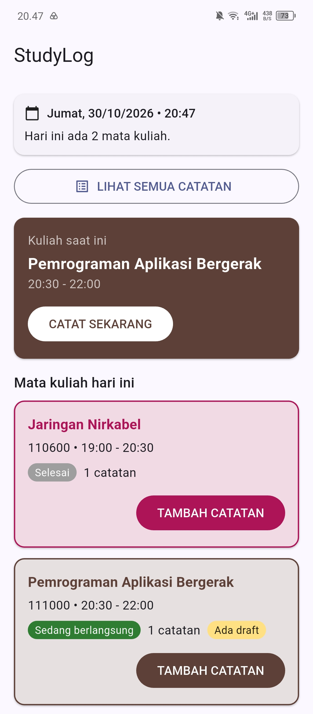
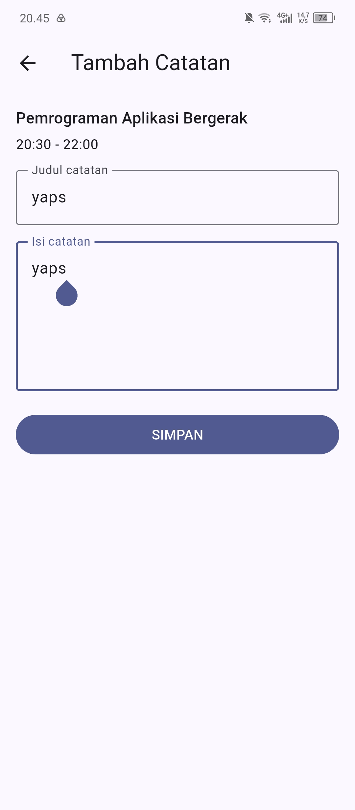
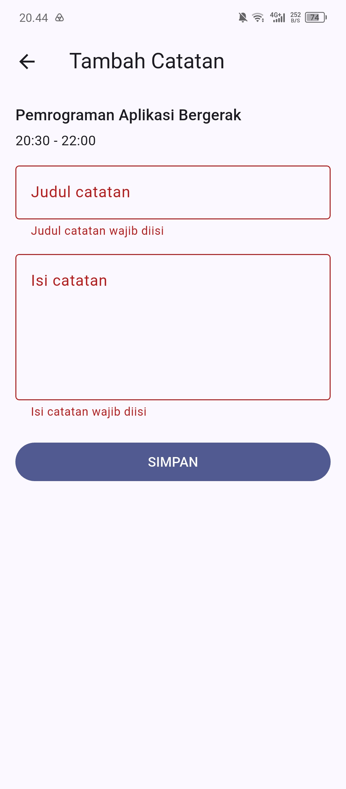
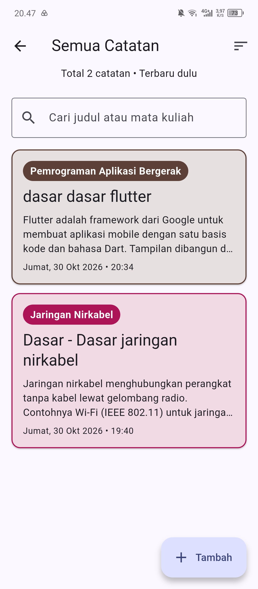
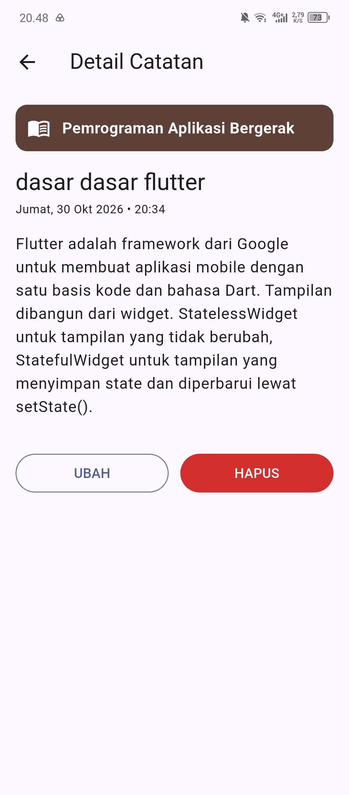
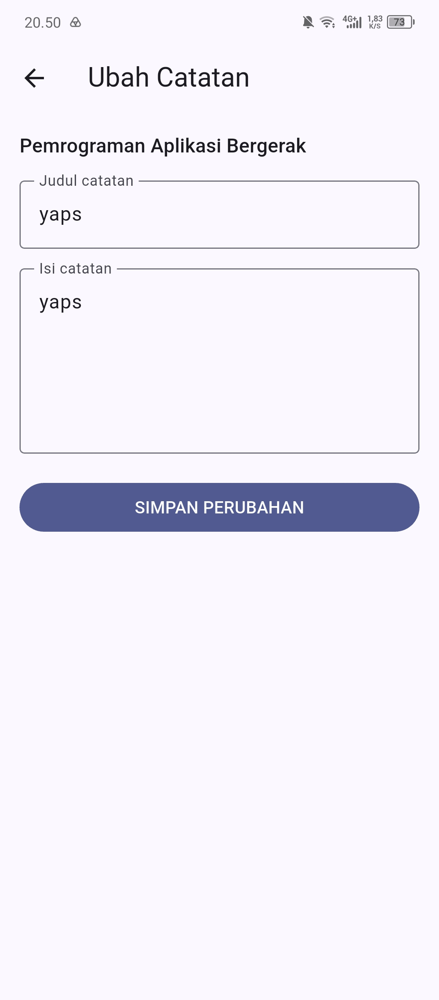
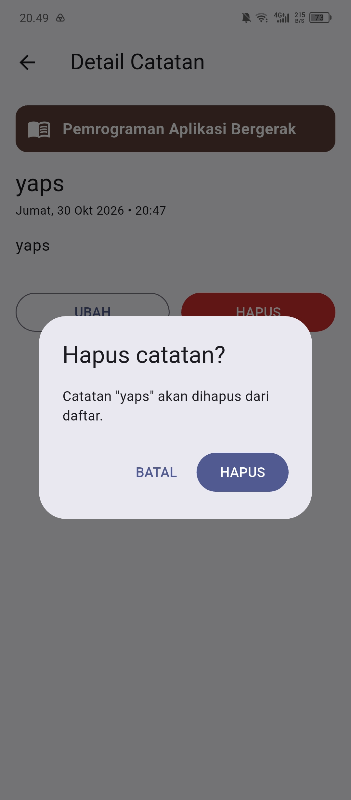

# StudyLog — Aplikasi Catatan Perkuliahan

Aplikasi catatan perkuliahan Android yang dibangun dengan **Flutter**. Catatan dikelompokkan per mata kuliah mengikuti **jadwal kuliah hari ini**, bekerja **tanpa internet**, dan **tetap tersimpan setelah aplikasi ditutup** karena memakai **SQLite lokal**.

> Tugas UTS kelompok — Program Studi Informatika, Universitas Mulia
> Mata kuliah: Pemrograman Aplikasi Bergerak

| | |
|---|---|
| **Video demo** | [https://drive.google.com/file/d/1VawqErV_PF8KuG7oNVX-FZudcpfxo3sF/view?usp=sharing](#video-demo) |
| **Repository** | https://github.com/nandarifaldo9-sudo/StudyLog |
| **Perwakilan demo** | Fachrel Kiesha Safyolla |

---

## Fitur

### Dashboard (Beranda)
- Menampilkan **hanya mata kuliah yang berlangsung hari ini**, mengikuti hari pada perangkat secara real time, lengkap dengan **kode mata kuliah dan jam kuliah**.
- Info hari, tanggal, dan jam yang diperbarui setiap menit dan saat aplikasi dibuka kembali.
- **Status kuliah otomatis**: *Akan datang*, *Sedang berlangsung*, atau *Selesai*, mengikuti jam saat ini.
- **Kartu "Kuliah saat ini"** dengan tombol **CATAT SEKARANG** yang langsung membuka form untuk mata kuliah yang sedang berlangsung.
- Setiap mata kuliah punya **card dengan warna khas**, jumlah catatan, dan tombol **TAMBAH CATATAN**.
- Penanda **"Ada draft"** pada mata kuliah yang masih punya catatan belum selesai.
- Pada **Sabtu dan Minggu** tidak ada jadwal, sehingga tombol tambah catatan tidak tersedia. Tombol **LIHAT SEMUA CATATAN** tetap ada setiap hari.

### Catatan: Create, Read, Update, Delete (CRUD)
| Operasi | Cara |
|---|---|
| **Create** | TAMBAH CATATAN atau CATAT SEKARANG → isi judul dan isi → SIMPAN |
| **Read** | LIHAT SEMUA CATATAN → ketuk catatan untuk membuka layar Detail |
| **Update** | Detail → UBAH → ubah judul/isi → SIMPAN PERUBAHAN |
| **Delete** | Detail → HAPUS → dialog konfirmasi (BATAL / HAPUS) |

- **Mata kuliah tidak dipilih manual.** Mata kuliah otomatis mengikuti card yang dipilih di dashboard.
- **Validasi**: field kosong dan field yang hanya berisi spasi ditolak (memakai `trim()`).
- **Tanggal dan jam pembuatan** tampil lengkap pada card dan Detail, contoh: `Jumat, 30 Okt 2026 • 19:28`.
- **Umpan balik**: `SnackBar` untuk status berhasil maupun gagal, serta dialog konfirmasi sebelum menghapus.
- **Draft otomatis** per mata kuliah, tersimpan saat mengetik, saat keluar dari halaman, dan saat aplikasi ditinggalkan. Draft dipulihkan ketika form dibuka lagi, walau aplikasi sempat ditutup total.
- **Penyimpanan permanen di SQLite**: catatan tetap ada setelah aplikasi ditutup total dan dibuka kembali.

### Pengembangan pilihan (PjBL)

**1. Pencarian**
- Kolom cari di layar **Semua Catatan**, dengan tombol hapus pencarian (✕).
- Mencocokkan **judul atau mata kuliah**, tidak membedakan huruf besar/kecil. Isi catatan tidak ikut dicari.
- Hasil langsung berubah saat mengetik, dengan jumlah hasil dan pesan saat tidak ada yang cocok.
- Logika ada di `CatatanViewModel.telusuri()`, sehingga layar tidak berisi logika pencarian.

**2. Urutkan catatan**
- Ikon urut di AppBar layar **Semua Catatan** memilih **Terbaru dulu** atau **Terlama dulu**.
- Urutan berlaku bersama pencarian. Pilihan aktif dan jumlah catatan tampil di bawah judul, contoh: `Total 2 catatan • Terlama dulu`.
- Logika ada di `CatatanViewModel.telusuri(..., urutan:)` dan enum `UrutanCatatan`.

---

## Cuplikan Layar

|                            Dashboard                            |                                     Form tambah                                     |                                   Validasi form kosong                                    |
|:---------------------------------------------------------------:|:-----------------------------------------------------------------------------------:|:-----------------------------------------------------------------------------------------:|
|  |  |  |

|                              Semua catatan                               |                               Detail catatan                               |                              Ubah catatan                              |
|:------------------------------------------------------------------------:|:--------------------------------------------------------------------------:|:----------------------------------------------------------------------:|
|  |  |  |

|                              Dialog hapus                              |
|:----------------------------------------------------------------------:|
|  |

---

## Video Demo

- **Tautan:** https://drive.google.com/file/d/1VawqErV_PF8KuG7oNVX-FZudcpfxo3sF/view?usp=sharing
- **Durasi:** 4 Menit 55 Detik
- **Isi video:** Create, Read, Update, Delete, membuka ulang aplikasi untuk membuktikan data tetap ada, lalu dua fitur tambahan (Pencarian dan Urutkan).

> Catatan: tanggal perangkat saat merekam sengaja diatur ke hari kuliah (Senin–Jumat) supaya dashboard menampilkan mata kuliah hari itu.

---

## Instalasi

### Prasyarat

| Kebutuhan | Keterangan |
|---|---|
| Flutter SDK | Dikembangkan dengan Flutter 3.47.4 (channel stable) |
| Android Studio | Dengan plugin **Flutter** dan **Dart** |
| Android SDK | Beserta emulator (AVD), atau HP Android dengan USB debugging aktif |
| Git | Untuk mengambil kode dari GitHub |

Periksa kesiapan lingkungan:

```bash
flutter doctor
```

Bagian Flutter, Android toolchain, dan Android Studio harus bertanda ✓.

### Langkah instalasi

```bash
# 1. Ambil kode
git clone https://github.com/nandarifaldo9-sudo/StudyLog.git
cd StudyLog

# 2. Ambil dependensi
flutter pub get
```

Dependensi utama di `pubspec.yaml`:

| Paket | Fungsi |
|---|---|
| `provider` | State management (`ChangeNotifier`) |
| `sqflite`, `path` | Database SQLite lokal |
| `sqflite_common_ffi_web` | Pendukung SQLite saat dijalankan di web |
| `shared_preferences` | Penyimpanan draft otomatis |

---

## Cara Menjalankan

### 1. Siapkan perangkat

- **Emulator:** Android Studio → **Tools → Device Manager** → buat dan jalankan Virtual Device.
- **HP Android:** aktifkan *Developer options* dan *USB debugging*, sambungkan lewat USB, lalu setujui kotak "Allow USB debugging".

Pastikan perangkat terbaca:

```bash
flutter devices
```

### 2. Jalankan aplikasi

```bash
flutter run
```

Atau di Android Studio: pilih perangkat di toolbar, lalu klik tombol hijau **▶ Run** (`Shift+F10`).

### 3. Perintah berguna

| Perintah | Fungsi |
|---|---|
| `r` (di terminal `flutter run`) | Hot reload |
| `R` | Hot restart |
| `flutter analyze` | Analisis statis kode |
| `flutter test` | Menjalankan seluruh pengujian |
| `flutter clean` | Membersihkan cache build |
| `flutter run --release` | Jalankan mode release (tanpa koneksi debug) |

### 4. Mencoba aplikasi pada hari non-kuliah

Aplikasi membaca hari dan jam dari perangkat. Di luar hari kuliah, tombol tambah catatan tidak tersedia. Untuk mencoba:

1. Buka **Settings → Date & time**, matikan pengaturan tanggal dan waktu otomatis.
2. Atur ke hari kuliah, misalnya **Jumat pukul 19:30** (Jaringan Nirkabel sedang berlangsung).
3. Tutup total lalu buka kembali aplikasi.
4. Setelah selesai, nyalakan lagi pengaturan otomatis.

## Struktur Proyek

> Susunan berikut disesuaikan dengan isi repository. Jalankan `tree lib /F` untuk memeriksa susunan terbaru.

```text
StudyLog/
├── android/                          # Konfigurasi platform Android
├── lib/
│   ├── main.dart                     # Titik masuk: ViewModel + repository SQLite + Provider
│   ├── data/
│   │   ├── jadwal.dart               # Jadwal kuliah, status, format tanggal dan jam
│   │   ├── draft_keys.dart           # Kunci penyimpanan draft per mata kuliah
│   │   ├── database_helper.dart      # Membuka studylog.db, membuat dan memigrasi tabel
│   │   ├── catatan_repository.dart   # Kontrak CRUD + SqliteCatatanRepository
│   │   └── memori_catatan_repository.dart  # Repository memori untuk pengujian
│   ├── models/
│   │   └── catatan.dart              # Model catatan + toMap()/fromMap()
│   ├── theme/
│   │   └── warna_mata_kuliah.dart    # Warna unik setiap mata kuliah
│   ├── viewmodels/
│   │   └── catatan_view_model.dart   # CatatanViewModel (ChangeNotifier), UrutanCatatan
│   ├── screens/
│   │   ├── dashboard_page.dart       # Beranda: jam real time, mata kuliah hari ini
│   │   ├── daftar_catatan_page.dart  # Semua Catatan: cari + urutkan
│   │   ├── detail_catatan_page.dart  # Detail: isi lengkap, UBAH, HAPUS
│   │   └── tambah_catatan_page.dart  # Form tambah/ubah, validasi, draft
│   └── widgets/
│       ├── mata_kuliah_card.dart     # Card mata kuliah + tombol tambah catatan
│       └── catatan_card.dart         # Card catatan berwarna (dapat diketuk)
├── test/                             # Pengujian unit dan widget (lihat bagian Pengujian)
├── screenshots/                      # Bukti tangkapan layar
├── pubspec.yaml                      # Dependensi proyek
└── README.md
```

---

## Pengujian

```bash
flutter analyze
flutter test
```

Jalankan `flutter test` untuk melihat jumlah dan hasil seluruh pengujian otomatis.

### Pengujian otomatis (folder `test/`)

| Area | Cakupan |
|---|---|
| Jadwal | Batas jam status kuliah (18:59, 19:00, 20:29, 20:30), tidak ada jadwal akhir pekan, warna unik, sesi tidak bertabrakan |
| Model | `catatan_model_test.dart`: konversi model ke/dari map SQLite |
| ViewModel | Tambah, ubah, hapus, muat, galat, dan persistensi memakai repository memori |
| Navigasi | Alur antarlayar, ubah, dan hapus |
| Pencarian | `pencarian_test.dart`: judul, mata kuliah, tidak ditemukan, hapus pencarian |
| Urutkan | `urutan_test.dart`: terbaru dulu, terlama dulu, urutan bersama pencarian |
| Widget | Dashboard per hari dan jam, form, validasi, draft |

### Matriks uji manual

Isi kolom **Hasil** (Lulus / Gagal) dan **Catatan kendala** setelah mencoba di perangkat.

#### CRUD dan SQLite

| ID | Skenario | Langkah | Ekspektasi | Hasil | Catatan kendala |
|----|----------|---------|------------|-------|-----------------|
| T1 — Create | Tambah catatan | Isi judul + isi → SIMPAN | Item baru muncul | | |
| T2 — Read | Buka daftar dan detail | LIHAT SEMUA CATATAN → buka catatan | Data sesuai input | | |
| T3 — Update | Ubah judul | Detail → UBAH → SIMPAN PERUBAHAN | Data terbaru tampil | | |
| T4 — Delete batal | Hapus lalu Batal | HAPUS → BATAL | Item tidak dihapus | | |
| T5 — Delete setuju | Hapus lalu konfirmasi | HAPUS → HAPUS | Item hilang | | |
| T6 — Persistence | Tutup total dan buka lagi | Swipe dari recent apps, buka lagi | Data masih tersedia | | |
| T7 — Validasi | Simpan field kosong | SIMPAN dengan judul kosong | Pesan validasi tampil | | |

#### Pencarian

| ID | Skenario | Langkah | Yang diharapkan | Hasil | Catatan kendala |
|----|----------|---------|-----------------|-------|-----------------|
| T9 | Cari judul | Daftar → ketik sebagian judul | Hanya catatan yang cocok tampil | | |
| T10 | Cari mata kuliah | Daftar → ketik sebagian nama mata kuliah | Semua catatan mata kuliah itu tampil | | |
| T11 | Tidak ditemukan | Daftar → ketik kata acak | Pesan "Tidak ada catatan yang cocok" | | |
| T12 | Hapus pencarian | Tekan ✕ pada kolom cari | Semua catatan tampil kembali | | |
| T13 | Pencarian + CRUD | Cari → buka Detail → UBAH/HAPUS → kembali | Daftar hasil ikut diperbarui | | |

#### Urutkan

| No | Skenario | Langkah | Yang diharapkan | Hasil | Catatan kendala |
|----|----------|---------|-----------------|-------|-----------------|
| 1 | Terlama dulu | Daftar → ikon urut → Terlama dulu | Catatan terlama di atas | | |
| 2 | Kembali terbaru | Ikon urut → Terbaru dulu | Catatan terbaru di atas | | |
| 3 | Urut + cari | Pilih Terlama dulu → ketik kata kunci | Hasil terfilter dan urut terlama | | |

#### Dashboard, draft, dan tanggal

| ID | Skenario | Langkah | Yang diharapkan | Hasil | Catatan kendala |
|----|----------|---------|-----------------|-------|-----------------|
| D1 | Mata kuliah hari ini | Buka aplikasi pada hari kuliah | Hanya mata kuliah hari itu tampil, lengkap dengan kode dan jam | | |
| D2 | Kuliah saat ini | Atur jam ke dalam sesi kuliah | Kartu "Kuliah saat ini" muncul; CATAT SEKARANG membuka form | | |
| D3 | Akhir pekan | Atur tanggal ke Sabtu | Keterangan tidak ada kuliah, tanpa tombol tambah | | |
| D4 | Draft | Ketik sebagian, tekan Back, buka form lagi | "Ada draft" tampil, isian pulih | | |
| D5 | Tanggal catatan | Simpan catatan, lihat card dan Detail | Tampil `Hari, tgl bln thn • jam` | | |

---

## Riwayat Pengembangan per Milestone

| Milestone | Isi | Berkas utama |
|---|---|---|
| **M1** | Form tambah catatan, validasi, `setState`, `SnackBar`, dashboard jadwal, draft | `dashboard_page.dart`, `tambah_catatan_page.dart`, `data/jadwal.dart` |
| **M2** | Empat layar (Beranda, Daftar, Detail, Form), `Navigator`, state lintas layar dengan `ChangeNotifier` + `Provider` | `daftar_catatan_page.dart`, `detail_catatan_page.dart`, `viewmodels/` |
| **M3** | Penyimpanan permanen SQLite dan CRUD, repository, migrasi database | `database_helper.dart`, `catatan_repository.dart`, `memori_catatan_repository.dart` |
| **Pengembangan** | Pencarian dan Urutkan catatan | `catatan_view_model.dart`, `daftar_catatan_page.dart`, `pencarian_test.dart`, `urutan_test.dart` |
| **Tambahan** | Tanggal lengkap pada catatan, dokumentasi, screenshot | `data/jadwal.dart`, `catatan_card.dart`, `README.md`, `screenshots/` |

## Kontribusi Anggota

> **Isi sebelum dikumpulkan.** Nama, NIM, dan bagian pekerjaan harus sesuai kenyataan. Bukti kontribusi bisa dilihat di riwayat commit dan pull request GitHub.

| No | Nama                   | NIM     | Peran / bagian yang dikerjakan          |
|----|------------------------|---------|-----------------------------------------|
| 1 | Rifaldo Ikhwan Nanda   | 2411026 | M2 - NAVIGASI & STATE (urutan)          | 
| 2 | Fachrel Kiesha Safyolla | 2411018 | M1 - Interaksi Pengguna dan dokumentasi |
| 3 | Dimas Putra Wijaya     | 2411031 | M3 -  LOCAL DATABASE (pencarian)        |